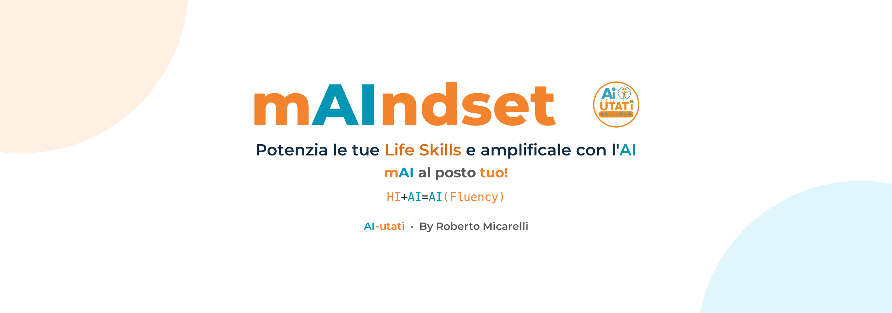
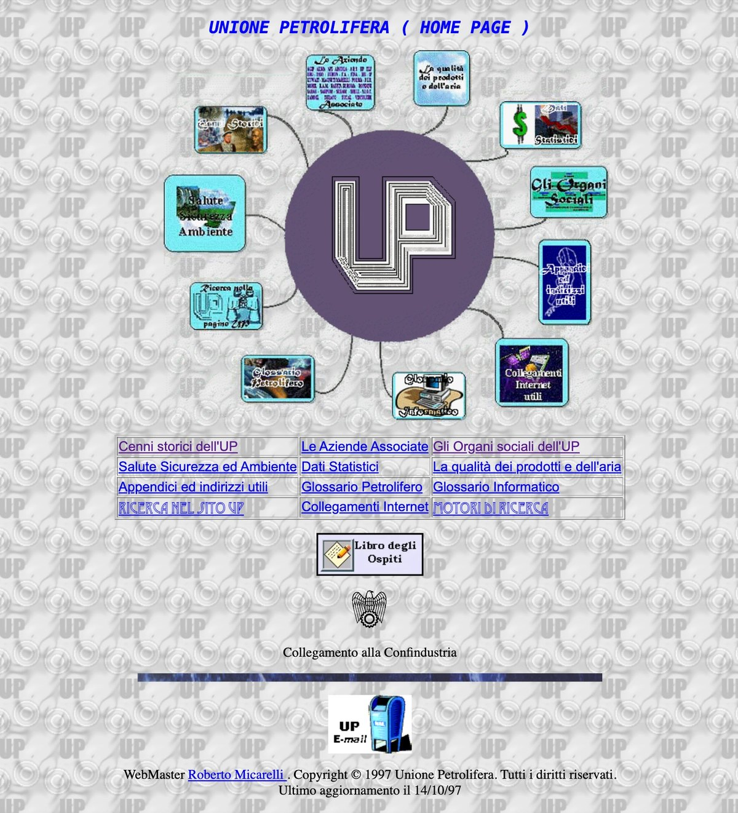
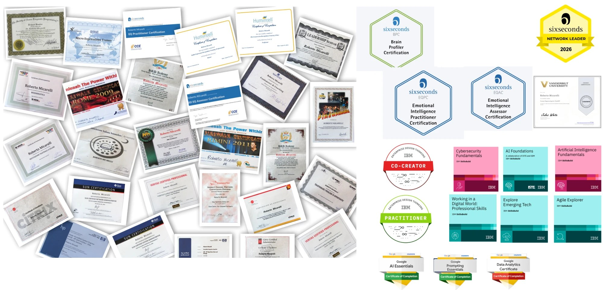

  

  
  
  

**AI-utati è un approccio antropocentrico all'uso dell'Intelligenza Artificiale nel lavoro reale.** Unisce formazione, coaching e consulenza, per aiutarti a riconoscere quando e come l'AI può creare valore senza dover essere un esperto né un guru del settore. L'ha fondato [Roberto Micarelli](https://www.ai-utati.it/informazioni/), formatore, coach e consulente con oltre 40 anni di esperienza.

Questo repository è la vetrina: le parole del brand, la storia, e i progetti che ho costruito per capire e usare l'AI. Ogni voce rimanda al [sito](https://www.ai-utati.it), che resta la fonte ufficiale.

## Le parole di AI-utati

| Parola | Cosa significa |
|---|---|
| **AI-utati** | Il nome si legge in due modi: «aiutati», l'invito a crescere, e «AI», la tecnologia che abilita |
| **mAIndset** | Il mindset di crescita aumentato dall'AI. Dentro la parola c'è l'AI, ma la parola resta quella di sempre. Si scrive senza trattini |
| **AI(Fluency)** | Le competenze che permettono di riconoscere quando e come l'AI può creare valore. Non è saper usare uno strumento: è saper giudicare quando serve e quando no |
| **`HI+AI=AI(Fluency)`** | La formula del metodo. L'Intelligenza Umana (HI) sommata all'Intelligenza Artificiale (AI) produce AI(Fluency), che resta una competenza umana applicata all'AI |
| **Human-in-the-Loop** | La persona resta dentro il processo: controllo e validazione umana a ogni passaggio critico. L'AI è co-pilota, mai pilota automatico |
| **Fusion Skills** | La fusione tra competenze tecniche e umane, nel lessico di World Economic Forum, McKinsey, Accenture e OCSE |

Le definizioni complete, con il racconto di come è nato il BrandBook: [L'idea del Brand AI-utati](https://www.ai-utati.it/risorse/idea-brand-ai-utati/).

## Un po' di storia

**I due colori c'erano già.** Nel 2015, per il video di presentazione di NOCOM, scelsi due colori a istinto. Oggi sono la regola del brand: l'arancione è l'umano, il blu è l'intelligenza artificiale. Il clip di 36 secondi «Da NOCOM ad AI-utati» racconta come ci sono arrivato ([guardalo sul sito](https://www.ai-utati.it/)).

| Anni | Cosa è successo |
|---|---|
| 1983–1993 | Informatica, laurea in Matematica alla Sapienza con tesi sulle reti neurali, ricercatore all'Istituto Superiore di Sanità |
| 1994–2009 | Consulenze di tecnologia, siti web e formazione per aziende, associazioni e professionisti, tra cui l'Unione Petrolifera |
| 2000–2010 | Direzione tecnica e pre-vendita in ambito ICT; responsabile del Centro Formazione di Roma di Sun Microsystems |
| 2000–2025 | Formazione e coaching: PNL (Practitioner, Master Practitioner, Trainer), comunicazione, public speaking |
| 2010–2025 | Fondazione di NOCOM; certificazioni in intelligenza emotiva (Six Seconds), microespressioni e scienza della felicità. Nel 2016 NOCOM cura il coordinamento didattico del [Corso di perfezionamento «Gestione del cambiamento: PNL e resilienza»](https://www.unicampus.it/master-phd/corso-di-perfezionamento-in-gestione-del-cambiamento-pnl-e-resilienza-i-edizione/) all'Università Campus Bio-Medico di Roma ([locandina PDF](https://www.unicampus.it/2.0/wp-content/uploads/2023/08/SFPL_Corso_Perfezionamento_PNL_Resilienza-1.pdf), [English page](https://www.unicampus.it/en/masters-phd/advanced-course-in-change-management-pnl-and-resilience-i-edition/)) |
| 2023–oggi | Nasce AI-utati: formazione di professionisti, aziende e docenti sull'integrazione di AI e competenze umane |

Il percorso completo è su [Percorso e competenze](https://www.ai-utati.it/percorso-e-competenze/).

### Il primo sito, prima di Google

Il primo sito dell'Unione Petrolifera l'ho pensato quando Google non esisteva ancora, l'ADSL non c'era e ogni pagina si scriveva a mano, in HTML. Si entrava in rete con un modem a 36k e ogni minuto in linea finiva in bolletta.

  
   
  La home page dell'Unione Petrolifera nell'archivio di Internet, 26 gennaio 1998. <a href="https://web.archive.org/web/19980126223427/http://www.unionepetrolifera.it/">Apri l'originale su Wayback Machine</a>.

In fondo si legge «WebMaster Roberto Micarelli», © 1997, ultimo aggiornamento 14 ottobre 1997.

## Le certificazioni

Una selezione dei titoli, dai corsi tecnici di Sun, HP, Veritas e Citrix alla PNL e alla comunicazione non verbale, fino all'intelligenza emotiva con Six Seconds e ai badge su AI di IBM e Google.

  

Le certificazioni Six Seconds sono attive e si verificano nella [directory ufficiale](https://cert.6seconds.org/cert-directory?id=003QP0000026RfiYAE).

## I progetti

Strumenti ed esperienze che si aprono nel browser. Ognuno ha una scheda sul sito e il codice qui su GitHub.

| | |
|---|---|
|  | **Queneau · AI-utati.** Dagli *Esercizi di stile* a token, embedding e attention, in sette atti. [Scheda](https://www.ai-utati.it/risorse/idea-queneau/) · [Demo](https://queneau-aiutati-all-in-one.vercel.app) · [Codice](https://github.com/RobertoMicarelli/queneau-aiutati-all-in-one) |
|  | **Cognitive Bias Explorer.** 231 bias cognitivi da esplorare e comprendere, con un'attività d'aula per ciascuno. [Scheda](https://www.ai-utati.it/risorse/cognitive-bias-explorer/) · [Demo](https://ai-utati-bias-explorer.vercel.app) · [Codice](https://github.com/RobertoMicarelli/AI-utati_Bias_Explorer) |
|  | **Mermaid Sketcher.** Dallo schizzo a mano libera al diagramma Mermaid. [Scheda](https://www.ai-utati.it/risorse/mermaid-sketcher/) · [Demo](https://mermaid-sketcher-one.vercel.app) · [Codice](https://github.com/RobertoMicarelli/mermaid-sketcher) |
|  | **Il problema degli N-corpi.** Simulatore interattivo della danza gravitazionale tra corpi celesti. [Scheda](https://www.ai-utati.it/risorse/problema-n-corpi/) · [Demo](https://robertomicarelli.github.io/3bodyproblem/) · [Codice](https://github.com/RobertoMicarelli/3bodyproblem) |
|  | **Voice Transcription Studio.** Dalla tua voce a una mappa mentale, con l'AI. [Scheda](https://www.ai-utati.it/risorse/voice-transcription-studio/) · [Demo](https://voice-transcription-studio-vercel.vercel.app) · [Codice](https://github.com/RobertoMicarelli/voice-transcription-studio-vercel) |

## Come lavoro con l'AI

Ogni passaggio importante si fa due volte: una per produrre, una per contestare. Chi scrive una regola non è chi la verifica, e chi verifica ha il compito di cercare l'errore. Le decisioni che contano le prende una persona. Usare l'AI non è disonesto; lo è usarla senza dichiararlo.

Per questo lo dico: **i testi di questo repository sono stati preparati con l'aiuto di Claude e verificati sulle pagine di [ai-utati.it](https://www.ai-utati.it).**

## Dove trovarmi

[Sito](https://www.ai-utati.it) · [Contatti](https://www.ai-utati.it/contatti/) · [YouTube](https://www.youtube.com/@AIutati) · [LinkedIn](https://www.linkedin.com/in/robertomicarelli)

---

**AI-utati** · By Roberto Micarelli · Formatore, Coach, Consulente

**Il prossimo passo:** apri un progetto, provalo per cinque minuti e poi scrivimi cosa hai capito.
